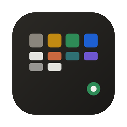
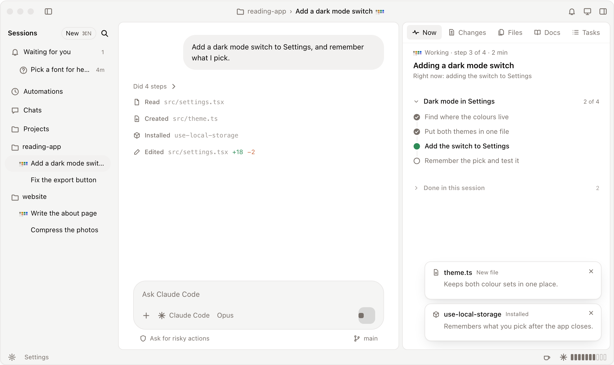
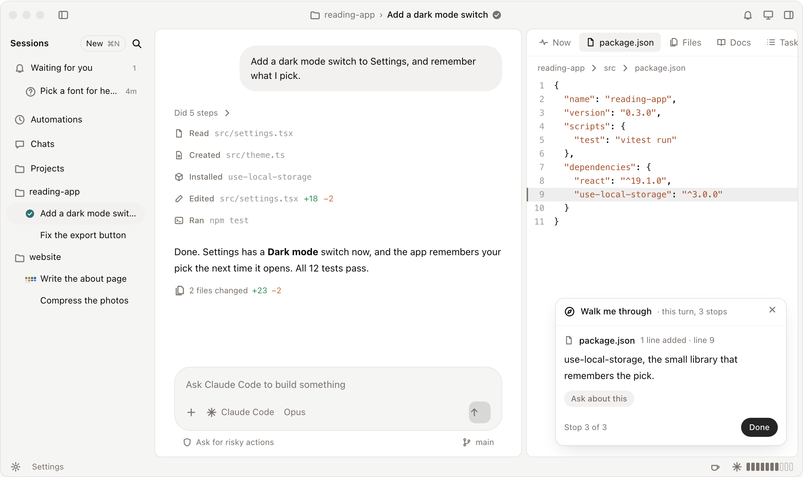

<p align="center"><a href="README.md">中文</a> · <a href="README.en.md">English</a> · <b>Deutsch</b></p>

<p align="center">
  
</p>

<h1 align="center">Dispatch</h1>

<p align="center">
Sehen, was Ihre KI gerade tut. Und dabei lernen.<br>
Eine Mac-App für Claude Code, Codex und OpenCode
</p>

<p align="center">
  <a href="https://dispatch.us-cloud.uk/?lang=de"><b>Website (auf Englisch)</b></a> ·
  <a href="https://github.com/SchaeferAnjon/dispatch/releases/latest"><b>Für den Mac herunterladen</b></a> ·
  <a href="https://github.com/SchaeferAnjon/dispatch/releases"><b>Was ist neu</b></a>
</p>

<p align="center">
  <a href="https://dispatch.us-cloud.uk/?lang=de"></a>
</p>

Dispatch ist eine macOS-App. Die Arbeit macht weiterhin der offizielle Kommandozeilen-Agent, den Sie installiert haben, mit Ihrem eigenen Abo; Dispatch gibt ihm ein Fenster, dem Sie folgen können, und rechts sehen Sie, was er bei jedem Schritt tut. Zu jeder Zeile können Sie fragen, warum.

**Kostenlos und quelloffen** (GPL-3.0) · Apple-Chip, macOS 14 oder neuer

## So läuft eine Runde

1. **Sagen**: Schreiben Sie in das Eingabefeld in einfachen Worten, was Sie wollen.
2. **Zusehen**: Der Tab Now rechts zeigt den Plan und den Schritt, an dem der Agent gerade ist; jede gelesene Datei, jede Änderung und jeder Befehl steht im Gespräch.
3. **Lernen**: Zu jeder neuen Datei und jedem neu installierten Paket erscheint rechts unten eine kleine Karte, die sagt, wozu sie da sind.
4. **Durchgehen**: Ist die Runde fertig, klicken Sie auf Walk me through und gehen die Änderungen Station für Station durch, mit einem Satz pro Station; wo etwas unklar ist, klicken Sie auf Ask about this.

<p align="center">
  
</p>

## Was drin ist

- **Eine App, zwei Fenster**: Dispatch Agent ist das Gespräch mit der rechten Seite, dort sagen Sie, was Sie wollen, und sehen zu; Dispatch IDE ist der vollständige Editor (ein Fork von VS Code 1.139.1), wenn Sie selbst am Code arbeiten wollen.
- **Die rechte Seite**: Now (der Plan und der aktuelle Schritt), Changes (die Änderungen Runde für Runde; Why oder More an einem Block sagt, warum er so geändert wurde), Files, Docs (die Dokumente und Seiten, die der Agent abliefert) und Tasks.
- **Lernen beim Arbeiten**: Unter Settings › Learning wählen Sie Quiet oder Talk. Bei Talk bringen neue Dateien und Pakete von selbst eine Karte, und am Ende einer Runde erscheint Walk me through in der Ecke; bei Quiet erscheint das nur, wenn Sie einen Knopf klicken oder Text markieren. Fachwörter in Antworten sind gepunktet unterstrichen; zeigen Sie darauf, erklärt ein Satz sie in einfachen Worten.
- **Direkt nachfragen**: Markieren Sie Text in einer Terminalausgabe oder einem Dokument und klicken Sie auf Ask Question; rechts unten öffnet sich ein Nebengespräch, das Hauptgespräch läuft ungestört weiter.
- **Aufgaben**: Jede Bitte von Ihnen ist eine Aufgabe. Der Agent schreibt seinen Plan, hält den Fortschritt fest und liefert mit dem Commit ab. Waiting for you in der Seitenleiste enthält nur, was Ihre Antwort oder Entscheidung braucht.
- **Auf einem anderen Mac laufen lassen**: Die erste Auswahl auf der Seite für eine neue Sitzung ist This Mac; wählen Sie einen anderen Mac aus Settings › Macs, läuft die Sitzung dort, mit dessen Dateien, Agenten und Anmeldungen.
- **Befehlszeile**: Was die Oberfläche zeigt, liefert auch `dispatch … --json`. Die Agenten nutzen dieselben Befehle und bekommen sie zusätzlich als MCP-Werkzeuge.

## Wo Ihre Daten bleiben

- Kein Konto, keine Nutzungsstatistik. Ihr Code und Ihre Gespräche gehen nur über den Agenten, den Sie installiert haben, an dessen eigenen Dienst, nie über uns.
- Dispatch hat kein eigenes Modell und ruft nie mit Ihrem Abo-Token direkt ein Modell auf. Braucht es einen Satz (etwa für eine Station in Walk me through, zu der keiner bereitliegt), fragt es den Agenten der Sitzung selbst.
- Aufgabenbrett, Vorlieben und Wissensbasis bleiben auf diesem Mac.
- Die Seite für Konten und Verbrauch liest die Anmeldungen, die Claude Code und Codex im Schlüsselbund und in lokalen Dateien ablegen, nur um bei deren offiziellen Diensten den Verbrauch abzufragen und Konten zu wechseln; Tokens werden nie ausgegeben oder protokolliert.

## Installation

### Aus einem Release installieren

1. Laden Sie unter [Releases](https://github.com/SchaeferAnjon/dispatch/releases/latest) `Dispatch-IDE-<Version>-macos-apple-silicon.dmg` herunter (oder das gleichnamige .zip). Veröffentlicht wird nur ein Paket für Apple-Chips; auf einem Intel-Mac bauen Sie es selbst, siehe unten „Aus dem Quellcode bauen“.
2. Öffnen Sie das dmg und ziehen Sie **Dispatch IDE.app** in den Ordner „Programme“.
3. Releases sind mit einer Developer ID signiert, aber nicht von Apple notarisiert: macOS blockiert den ersten Doppelklick. Klicken Sie auf „Fertig“ und geben Sie die App einmal frei, auf einem der beiden Wege:
   - Systemeinstellungen → Datenschutz & Sicherheit → nach unten bis „Sicherheit“, bei der Meldung, dass Dispatch IDE blockiert wurde, auf „Dennoch öffnen“ klicken; in der folgenden Rückfrage noch einmal „Dennoch öffnen“, dann mit dem Anmeldepasswort bestätigen;
   - oder im Terminal `xattr -dr com.apple.quarantine "/Applications/Dispatch IDE.app"` einfügen und die App danach per Doppelklick öffnen.

   Danach öffnet sie sich wie jede andere App.
4. Nach dem Öffnen startet automatisch die **Ersteinrichtung** (siehe unten „Ersteinrichtung“).

Homebrew brauchen Sie nicht, und das Aufgabenbrett müssen Sie nicht eigens installieren: bd und Dolt stecken in der App. Fehlen auf einem neuen Mac noch Apples Befehlszeilenwerkzeuge (Dispatch nutzt deren git und python3), installiert die erste Seite der Einrichtung sie mit dem Installationsprogramm von macOS.

Auch der Terminalbefehl `dispatch` steckt in der App. Klicken Sie am Ende der Einrichtung auf **Set up Dispatch**, wird er nach `~/.local/bin/dispatch` verlinkt und dieser Ordner in den PATH Ihrer Shell eingetragen; in einem neuen Terminal steht er dann bereit. Haben Sie die Einrichtung übersprungen, verlinken Sie ihn von Hand:

```sh
mkdir -p ~/.local/bin && ln -sf "/Applications/Dispatch IDE.app/Contents/Resources/app/dispatch-cli/dispatch/cli/dispatch.py" ~/.local/bin/dispatch
```

### Aktualisieren

- **Die App aktualisiert sich selbst**: Dispatch sucht regelmäßig nach einer neuen Version und lädt sie im Hintergrund aus den Releases dieses Repositorys. Ist sie bereit, erscheint unten links in der Statusleiste **Restart to update**; ein Klick auf Restart startet die neue Version, und jede Sitzung macht dort weiter, wo sie war. Mit Later wird sie beim nächsten Start von Dispatch installiert.
- **Von Hand**: Laden Sie das dmg erneut aus den [Releases](https://github.com/SchaeferAnjon/dispatch/releases/latest) und ziehen Sie die neue **Dispatch IDE.app** über die alte in den Ordner „Programme“.
- Aus dem Quellcode gebaut: neuen Code holen und `bash app/scripts/install.sh --local` noch einmal ausführen.

### Aus dem Quellcode bauen (für Entwickler)

Der Quellcode von Dispatch IDE liegt in diesem Repository unter `ide/vscode` (VS Code 1.139.1 mit den Änderungen von Dispatch); ein weiteres Repository ist nicht nötig. Erforderlich:

- ein Mac mit Apple-Chip, macOS 14+;
- Xcode Command Line Tools (`xcode-select --install`; der Build braucht `xcrun swiftc`);
- Python 3.9+ und git;
- Node.js in der Version aus `ide/vscode/.nvmrc` (derzeit 24.18.0). Ist das `node` im PATH eine andere Version, rufen die Build-Skripte es über [fnm](https://github.com/Schniz/fnm) auf; fehlt beides, brechen sie ab und sagen, was zu installieren ist;
- eine Internetverbindung: der Build lädt bd, Dolt, Codex und npm-Pakete.

```sh
brew install fnm
fnm install "$(cat ide/vscode/.nvmrc)" && fnm default "$(cat ide/vscode/.nvmrc)" && eval "$(fnm env)"
(cd app && npm ci)
bash app/scripts/install.sh --local   # baut Dispatch IDE auf diesem Mac, installiert /Applications/Dispatch IDE.app
```

Der erste Build installiert die Abhängigkeiten von VS Code und kompiliert alles: fünfzehn Minuten oder mehr. Ein selbst gebautes Paket ist ad hoc signiert und für den eigenen Mac gedacht.

Der Befehl `dispatch` nutzt `app/cli/dispatch.py` aus diesem Repository (`ln -sf "$PWD/app/cli/dispatch.py" ~/.local/bin/dispatch`). Den dauerhaft laufenden chatd (Dienst des Aufgabenbretts, Keep awake, andere Macs) installiert `dispatch chatd install`.

Das Aufgabenbrett ist [Beads](https://github.com/steveyegge/beads) (bd) auf Dolt, beides wird in die App gebaut; der Standardordner ist `~/tasks/.beads`, mit `BEADS_DIR` lässt er sich ändern.

## Ersteinrichtung

Beim ersten Öffnen zeigt Dispatch einen Einrichtungsassistenten. Solange Sie sich durch die Seiten klicken, ändert sich nichts; erst **Set up Dispatch** am Ende erledigt alles der Reihe nach. Was dabei geändert wurde, steht unter Settings › Abilities › What Dispatch changed on this Mac, jede Zeile mit Undo.

- **Agents**: findet Claude Code, Codex und OpenCode auf diesem Mac. Fehlt einer, klicken Sie auf Install; ist einer nicht angemeldet, auf Sign in. Claude Code und OpenCode installieren sich mit ihren eigenen Skripten; Codex mit Node.js oder, wenn Node.js fehlt, mit Homebrew, und fehlt beides, werden Sie gebeten, zuerst Node.js zu installieren.
- **Projects**: übernimmt die Ordner, in denen Ihre Agenten gearbeitet haben, als Projekte. Ein Ordner ohne git bekommt `git init`; sonst ändert sich darin nichts.
- **Preferences**: sucht Ihre Vorlieben aus CLAUDE.md, AGENTS.md und dem Gedächtnis der Agenten heraus, zum Ankreuzen und Übernehmen.
- **Agent permissions**: wann die Agenten Sie fragen, bevor sie Dateien ändern oder Befehle ausführen.
- **Appearance** und **Notifications**: wie Dispatch aussieht und worüber es Sie benachrichtigt.
- **Connect Dispatch to your agents**: zeigt vorher, was in die Regeldatei jedes Agenten kommt (ein Abschnitt über Dispatch, ein paar Hooks und die Werkzeuge für das Aufgabenbrett); was Sie selbst dort geschrieben haben, bleibt, wie es ist.

Auf einem neuen Mac beginnt der Assistent mit einer zusätzlichen Seite, die Apples Befehlszeilenwerkzeuge installiert, und ohne etwas zum Übernehmen fallen Projects und Preferences weg. Sie können auch Skip setup wählen und später über Set up in der Titelleiste zurückkommen.

## Mitwirken

- Die Code-Landkarte ist [ARCHITECTURE.md](ARCHITECTURE.md): wie eine Anfrage vom Fenster bis zur CLI läuft und welche Datei Sie für Ihre Änderung lesen.
- Dispatch IDE ist der Quellcode von VS Code 1.139.1 in `ide/vscode`. Neue Funktionen kommen in neue Dateien; die Originaldateien von VS Code bekommen nur kleine, mit `// Dispatch IDE:` markierte Einhängepunkte. Die Regeln stehen in [ide/README.md](ide/README.md).
- Tests:

```sh
cd app
npm test          # vitest
npm run test:py   # die Befehlszeile dispatch (Python)
```

- Tests arbeiten nur in temporären Ordnern und berühren nie Ihr echtes Aufgabenbrett oder Ihren Benutzerordner; fügen Sie keine echten Sitzungen, Konfigurationen, Schlüssel oder Screenshots zum Repository hinzu.

Der Code des Projekts steht unter [GPL-3.0-or-later](LICENSE). Code von Dritten behält seine eigene Lizenz; die Liste steht in [NOTICE](NOTICE).
