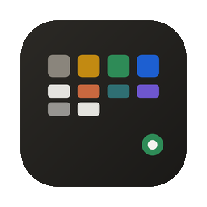
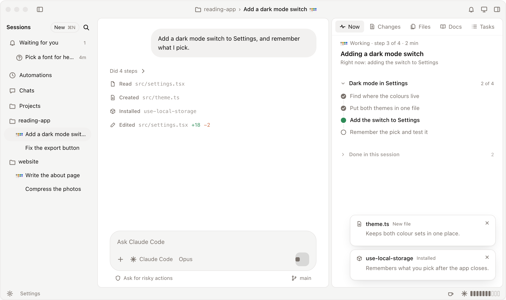
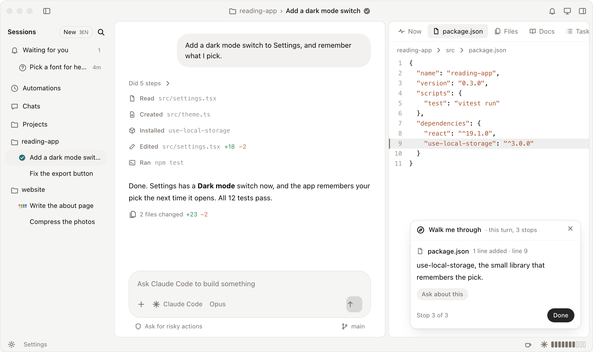

<p align="center"><a href="README.md">中文</a> · <b>English</b> · <a href="README.de.md">Deutsch</a></p>

<p align="center">
  
</p>

<h1 align="center">Dispatch</h1>

<p align="center">
See what your AI is doing. Learn while it works.<br>
A Mac app for Claude Code, Codex and OpenCode
</p>

<p align="center">
  <a href="https://dispatch.us-cloud.uk/?lang=en"><b>Website</b></a> ·
  <a href="https://github.com/SchaeferAnjon/dispatch/releases/latest"><b>Download for Mac</b></a> ·
  <a href="https://github.com/SchaeferAnjon/dispatch/releases"><b>What's new</b></a>
</p>

<p align="center">
  <a href="https://dispatch.us-cloud.uk/?lang=en"></a>
</p>

Dispatch is a macOS desktop app. The work is still done by the official command-line agent you installed, on your own subscription; Dispatch gives it a window you can follow, where the right side shows what it is doing at each step. Ask why at any line.

**Free and open source** (GPL-3.0) · Apple silicon, macOS 14 or later

## How a turn goes

1. **Ask**: say what you want in plain words in the message box.
2. **Watch**: the Now tab on the right shows the plan and the step it is on; every file the agent reads, every edit and every command it runs is listed in the conversation.
3. **Learn**: for each new file or newly installed package, a small card in the corner of the right side says what it is for.
4. **Review**: when the turn is done, click Walk me through and go through the changes one stop at a time, one sentence per stop; click Ask about this wherever something is unclear.

<p align="center">
  
</p>

## What's in it

- **One app, two windows**: Dispatch Agent is the conversation with the right side, where you ask and watch; Dispatch IDE is the full editor (a fork of VS Code 1.139.1) for when you want to change code yourself.
- **The right side**: Now (the plan and the current step), Changes (the changes by turn; Why or More on any block says why it was changed that way), Files, Docs (the documents and pages the agent hands over) and Tasks.
- **Learn while it works**: pick Quiet or Talk in Settings › Learning. Under Talk, new files and packages bring a card on their own, and Walk me through shows up in the corner when a turn ends; under Quiet they appear only when you click a button or select text. Developer words in replies have a dotted line under them; point at one for a sentence in plain words.
- **Ask on the spot**: select text in terminal output or a document and click Ask Question; a side chat opens in the corner of the right side, and the main conversation carries on undisturbed.
- **Tasks**: every request you make is a task. The agent writes its plan, logs progress and hands it over with the commit. Waiting for you in the sidebar holds only what needs your answer or decision.
- **Run on another Mac**: the first choice on the new session page is This Mac; pick another Mac added in Settings › Macs and the session runs there, with that Mac's files, agents and logins.
- **Command line**: whatever the interface shows, `dispatch … --json` can return. Agents use the same commands, and get them as MCP tools as well.

## Where your data stays

- No account and no usage tracking. Your code and conversations go only through the agent you installed to its own service, never through us.
- Dispatch has no model of its own and never uses your subscription token to call a model directly. When it needs a sentence (say, a stop in Walk me through that has none ready), it asks the session's own agent.
- The task board, your preferences and the knowledge base stay on this Mac.
- The account and usage page reads the logins Claude Code and Codex keep in the keychain and in local files, only to ask their official services for your usage and to switch accounts; tokens are never printed or logged.

## Installation

### Install from a Release

1. Go to [Releases](https://github.com/SchaeferAnjon/dispatch/releases/latest) and download `Dispatch-IDE-<version>-macos-apple-silicon.dmg` (or the .zip of the same name). Only an Apple silicon package is published; on an Intel Mac, build it yourself as described under "Build from source" below.
2. Open the dmg and drag **Dispatch IDE.app** into Applications.
3. Releases are signed with a Developer ID but not notarized by Apple, so macOS blocks the first double-click. Click Done, then allow it once, either way:
   - System Settings → Privacy & Security → scroll down to Security, where it says "Dispatch IDE" was blocked to protect your Mac, and click "Open Anyway"; in the question that comes up click "Open Anyway" again, then enter your login password and click OK;
   - Or open Terminal, paste `xattr -dr com.apple.quarantine "/Applications/Dispatch IDE.app"`, then double-click the app.

   After that it opens like any other app.
4. Once open, the app goes straight into **first-run setup** (see "First-run setup" below).

You need neither Homebrew nor a separate task board install: bd and Dolt come inside the app. On a new Mac without Apple's command line tools (Dispatch uses their git and python3), the first page of setup installs them with macOS's own installer.

The `dispatch` terminal command is inside the app too. When you click **Set up Dispatch** at the end of setup, it is linked to `~/.local/bin/dispatch` and that folder is added to your shell's PATH, so it works in a new terminal. If you skipped setup, link it by hand:

```sh
mkdir -p ~/.local/bin && ln -sf "/Applications/Dispatch IDE.app/Contents/Resources/app/dispatch-cli/dispatch/cli/dispatch.py" ~/.local/bin/dispatch
```

### Updating

- **The app updates itself**: Dispatch checks for a new version now and then and downloads it from this repository's Releases in the background. When it is ready, **Restart to update** shows in the bottom bar at the lower left; click Restart and the new version takes over, every session picking up where it was. Click Later instead and it installs the next time Dispatch starts.
- **By hand**: download the dmg again from [Releases](https://github.com/SchaeferAnjon/dispatch/releases/latest) and drag the new **Dispatch IDE.app** into Applications over the old one.
- Built from source: pull the new code and run `bash app/scripts/install.sh --local` again.

### Build from source (developers)

Dispatch IDE's source is in this repository, in `ide/vscode` (VS Code 1.139.1 with Dispatch's changes); no other repository is needed. Requires:

- a Mac with Apple silicon, macOS 14+;
- Xcode Command Line Tools (`xcode-select --install`; the build uses `xcrun swiftc`);
- Python 3.9+ and git;
- Node.js in the version `ide/vscode/.nvmrc` names (24.18.0 at the moment). When the `node` on your PATH is another version, the build scripts run it through [fnm](https://github.com/Schniz/fnm); with neither they stop and say what to install;
- a network connection: the build downloads bd, Dolt, Codex and npm packages.

```sh
brew install fnm
fnm install "$(cat ide/vscode/.nvmrc)" && fnm default "$(cat ide/vscode/.nvmrc)" && eval "$(fnm env)"
(cd app && npm ci)
bash app/scripts/install.sh --local   # builds Dispatch IDE on this Mac, installs /Applications/Dispatch IDE.app
```

The first build installs VS Code's dependencies and compiles everything: fifteen minutes or more. A package you build yourself is signed ad-hoc and meant for your own Mac.

The `dispatch` command runs this repository's `app/cli/dispatch.py` (`ln -sf "$PWD/app/cli/dispatch.py" ~/.local/bin/dispatch`). The resident chatd (the task board service, Keep awake, other Macs) is installed with `dispatch chatd install`.

The task board is [Beads](https://github.com/steveyegge/beads) (bd) on Dolt, both built into the app; its default folder is `~/tasks/.beads`, and `BEADS_DIR` overrides it.

## First-run setup

The first time it opens, Dispatch shows a setup wizard. Nothing changes while you click through the pages; only **Set up Dispatch** at the end does the work, in order. Everything it did is listed in Settings › Abilities › What Dispatch changed on this Mac, each line with Undo.

- **Agents**: finds Claude Code, Codex and OpenCode on this Mac. Click Install for one that is missing and Sign in for one that is not signed in. Claude Code and OpenCode install with their own scripts; Codex installs with Node.js, or with Homebrew when there is no Node.js, and with neither you are asked to install Node.js first.
- **Projects**: brings the folders your agents worked in over as projects. A folder without git gets `git init`; nothing else in it changes.
- **Preferences**: picks your preferences out of CLAUDE.md, AGENTS.md and the agents' memory for you to tick and import.
- **Agent permissions**: when agents check with you before they edit files or run commands.
- **Appearance** and **Notifications**: how Dispatch looks and what it tells you.
- **Connect Dispatch to your agents**: shows what it adds to each agent's rules file (one block about Dispatch, a few hooks and the task board tools) before it does; what you wrote there stays as it is.

On a new Mac the wizard starts with one more page that installs Apple's command line tools, and with nothing to bring over, Projects and Preferences are skipped. You can also Skip setup and come back later with Set up in the title bar.

## Contributing

- The code map is [ARCHITECTURE.md](ARCHITECTURE.md): how a request travels from the window to the CLI, and which file to read for what you want to change.
- Dispatch IDE is the VS Code 1.139.1 source in `ide/vscode`. New features go in new files; VS Code's own files only get small hooks marked `// Dispatch IDE:`. The rules are in [ide/README.md](ide/README.md).
- Tests:

```sh
cd app
npm test          # vitest
npm run test:py   # the dispatch command line (Python)
```

- Tests use temporary folders only and never touch your real task board or home folder; do not add real sessions, configuration, keys or screenshots to the repository.

The project's code is licensed under [GPL-3.0-or-later](LICENSE). Third-party code keeps its own licence; the list is in [NOTICE](NOTICE).
