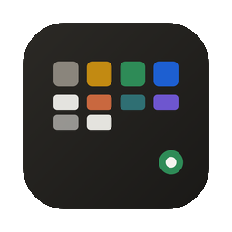
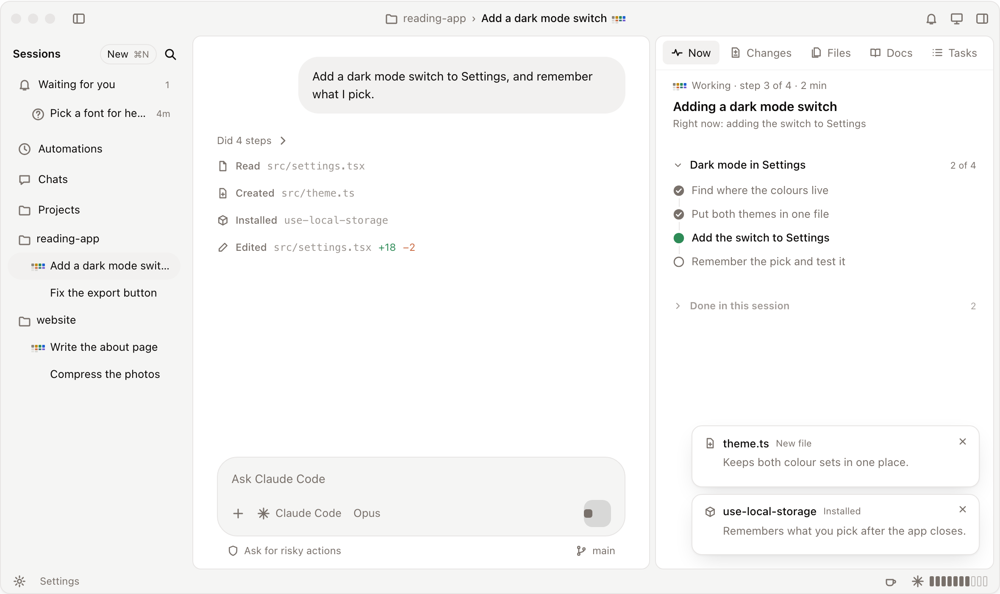
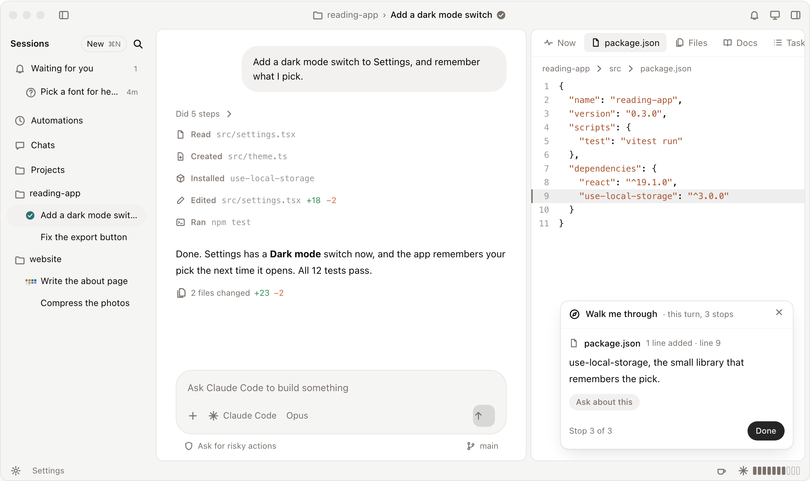

<p align="center"><b>中文</b> · <a href="README.en.md">English</a> · <a href="README.de.md">Deutsch</a></p>

<p align="center">
  
</p>

<h1 align="center">Dispatch</h1>

<p align="center">
AI 在做什么，看得懂；它做的时候，你也学会。<br>
给 Claude Code、Codex、OpenCode 用的 Mac 窗口
</p>

<p align="center">
  <a href="https://dispatch.us-cloud.uk/?lang=zh"><b>官网</b></a> ·
  <a href="https://github.com/SchaeferAnjon/dispatch/releases/latest"><b>下载 Mac 版</b></a> ·
  <a href="https://github.com/SchaeferAnjon/dispatch/releases"><b>更新了什么</b></a>
</p>

<p align="center">
  <a href="https://dispatch.us-cloud.uk/?lang=zh"></a>
</p>

Dispatch 是一个 macOS 桌面 App。干活的还是你装的官方命令行 Agent，用你自己的订阅；Dispatch 给它一扇看得清的窗口，你在右栏看懂它每一步在做什么，哪一行不懂就地问为什么。

**免费开源**（GPL-3.0）· Apple 芯片，macOS 14 及以上

## 一轮是怎么走的

1. **交代**：在输入框里用大白话说要什么。
2. **看着**：右栏 Now 里是计划和正在做的那一步；Agent 读了哪个文件、改了什么、跑了什么命令，都记在对话里。
3. **学到**：新建的文件、新装的包，右栏右下角各冒一张小卡，说是干什么的。
4. **回看**：这一轮做完，点 Walk me through，改动一站一站看，每站一句话；哪里不懂，点 Ask about this 接着问。

<p align="center">
  
</p>

## 都有什么

- **一个 App，两种窗口**：Dispatch Agent 是对话加右栏，平时在这里交代和看；Dispatch IDE 是完整的编辑器（VS Code 1.139.1 的分支），要自己动手改代码时用它。
- **右栏**：Now（计划和当前一步）、Changes（按轮看改动，每块改动点 Why 或 More 看为什么这么改）、Files、Docs（Agent 交出来的文档和网页）、Tasks。
- **边做边学**：Settings › Learning 里选 Quiet 或 Talk。Talk 时新文件、新包主动冒小卡，一轮做完右下角出现 Walk me through；Quiet 时这些只在你点按钮或选中文字时出现。回复里的术语下面有点线，指上去看一句大白话解释。
- **就地追问**：终端输出或文档里选一段字，点 Ask Question，右栏右下角开一段旁聊来问，主对话不受打扰。
- **任务**：你的每条需求是一件任务，Agent 自己写计划、记进展，交付时附上提交号。左栏 Waiting for you 只放等你回答或决定的事。
- **在另一台 Mac 上跑**：新会话页第一个选项默认是 This Mac，换成 Settings › Macs 里加的另一台，会话就跑在那台的文件、Agent 和登录上。
- **命令行**：界面上看得到的，`dispatch … --json` 都问得到；Agent 也用这一套，同时装成它们的 MCP 工具。

## 数据留在哪

- 不用注册，不收集使用数据。代码和对话只经过你装的 Agent 发给它自己的服务，不经过我们。
- Dispatch 不带自己的模型，也不拿你的订阅 token 直接调模型。要一句说明时（比如 Walk me through 里有几站没有现成的话），问的是这段会话自己的 Agent。
- 任务板、偏好和知识库都存在这台 Mac 上。
- 账号和用量页读取 Claude Code、Codex 存在钥匙串和本机文件里的登录，只用来向它们官方查用量、切换账号；token 不打印，也不写进日志。

## 安装

### 从 Release 安装

1. 到 [Releases](https://github.com/SchaeferAnjon/dispatch/releases/latest) 下载 `Dispatch-IDE-<版本>-macos-apple-silicon.dmg`（同名 .zip 也行）。目前只发布 Apple 芯片版，Intel 机器请按下面「从源码构建」自己打包。
2. 双击打开 dmg，把 **Dispatch IDE.app** 拖进「应用程序」。包有 Developer ID 签名，但没有经过 Apple 公证，第一次双击会被 macOS 拦下，点「完成」，再放行一次（两种都行）：
   - 系统设置 → 隐私与安全性 → 往下拉到「安全性」，在说 Dispatch IDE 被阻止的那一行点「仍要打开」；弹出的确认框里再点一次「仍要打开」，然后输入登录密码确认；
   - 或者终端里 `xattr -dr com.apple.quarantine "/Applications/Dispatch IDE.app"`，再双击。

   之后就和别的 App 一样双击打开。
3. 打开后直接进入**首次设置**（见下面「首次设置」一节）。

不需要 Homebrew，也不用另装任务板：bd 和 Dolt 打在 App 里。新 Mac 还没有 Apple 的命令行工具（Dispatch 要用里面的 git 和 python3）时，首次设置第一页先装它们，用的是 macOS 自己的安装器。

终端命令 `dispatch` 也在 App 里。首次设置最后点 **Set up Dispatch** 时，它被链接到 `~/.local/bin/dispatch`，这个目录也加进 shell 的 PATH，新开的终端里就能用。跳过了首次设置的话，手动链接：

```sh
mkdir -p ~/.local/bin && ln -sf "/Applications/Dispatch IDE.app/Contents/Resources/app/dispatch-cli/dispatch/cli/dispatch.py" ~/.local/bin/dispatch
```

### 更新

- **App 自己更新**：Dispatch 定期查有没有新版本，有就从本仓库的 Releases 在后台下好；下好后左下角底栏出现 **Restart to update**，点 Restart 就换上新版，各段会话接着原来的地方。点 Later 的话，下次打开 Dispatch 时装上。
- **手动**：到 [Releases](https://github.com/SchaeferAnjon/dispatch/releases/latest) 重新下载 dmg，把新的 **Dispatch IDE.app** 拖进「应用程序」替换旧的。
- 从源码装的：拉下新代码，再跑一次 `bash app/scripts/install.sh --local`。

### 从源码构建（开发者）

Dispatch IDE 的源码就在本仓库的 `ide/vscode`（VS Code 1.139.1 加上 Dispatch 的改动），不需要别的仓库。需要：

- Apple 芯片的 Mac，macOS 14+；
- Xcode Command Line Tools（`xcode-select --install`，构建时要用 `xcrun swiftc`）；
- Python 3.9+、git；
- Node.js，版本以 `ide/vscode/.nvmrc` 为准（现在是 24.18.0）。PATH 上的 `node` 不是这个版本时，构建脚本通过 [fnm](https://github.com/Schniz/fnm) 调用它，两样都没有会直接报错并告诉你装什么；
- 能联网：构建时下载 bd、Dolt、Codex 和 npm 包。

```sh
brew install fnm
fnm install "$(cat ide/vscode/.nvmrc)" && fnm default "$(cat ide/vscode/.nvmrc)" && eval "$(fnm env)"
(cd app && npm ci)
bash app/scripts/install.sh --local   # 在本机构建 Dispatch IDE，装到 /Applications/Dispatch IDE.app
```

第一次构建要装 VS Code 的依赖、整个编译一遍，十几分钟起。自己打的包是临时签名（ad-hoc），只在本机用。

`dispatch` 命令直接用本仓库的 `app/cli/dispatch.py`（`ln -sf "$PWD/app/cli/dispatch.py" ~/.local/bin/dispatch`）。后台常驻的 chatd（任务板服务、Keep awake、多台 Mac）用 `dispatch chatd install` 装上。

任务板是 [Beads](https://github.com/steveyegge/beads)（bd）加 Dolt，构建时一起打进 App；默认目录是 `~/tasks/.beads`，可用 `BEADS_DIR` 指定。

## 首次设置

第一次打开是一个设置向导。一页页点过去时什么都不改，最后点 **Set up Dispatch** 才按顺序做；做过的每一项都列在 Settings › Abilities › What Dispatch changed on this Mac，每条都能 Undo。

- **Agents**：找到这台 Mac 上的 Claude Code、Codex、OpenCode。没装的点 Install，没登录的点 Sign in。Claude Code 和 OpenCode 用它们自己的安装脚本；Codex 用 Node.js 装，没有 Node.js 就用 Homebrew，两样都没有时会让你先装 Node.js。
- **Projects**：把 Agent 干过活的文件夹收成项目。没有 git 的会 `git init`，别的不动。
- **Preferences**：从 CLAUDE.md、AGENTS.md 和 Agent 的记忆里挑出你的偏好，勾选导入。
- **Agent permissions**：Agent 改文件、跑命令之前，什么时候先问你。
- **Appearance**、**Notifications**：外观和通知。
- **Connect Dispatch to your agents**：在每个 Agent 的规则文件里加一段 Dispatch 的说明、几个钩子和任务板工具，先列给你看；文件里你自己写的内容不动。

新 Mac 上向导前面多一页，先装 Apple 的命令行工具；没有可带过来的东西，Projects 和 Preferences 两页会跳过。也可以 Skip setup，以后点标题栏的 Set up 再来。

## 参与开发

- 代码地图在 [ARCHITECTURE.md](ARCHITECTURE.md)：一条请求从界面走到 CLI 的路线，想改什么该看哪个文件。
- Dispatch IDE 是 `ide/vscode` 里的 VS Code 1.139.1 源码。新功能放新文件，VS Code 原文件只加标了 `// Dispatch IDE:` 的挂钩，规矩见 [ide/README.md](ide/README.md)。
- 测试：

```sh
cd app
npm test          # vitest
npm run test:py   # 命令行 dispatch（Python）
```

- 测试只用临时目录，不碰真实的任务板和主目录；不要把真实会话、配置、密钥或截图加进仓库。

项目代码采用 [GPL-3.0-or-later](LICENSE)。第三方代码保留各自许可证，清单在 [NOTICE](NOTICE)。
